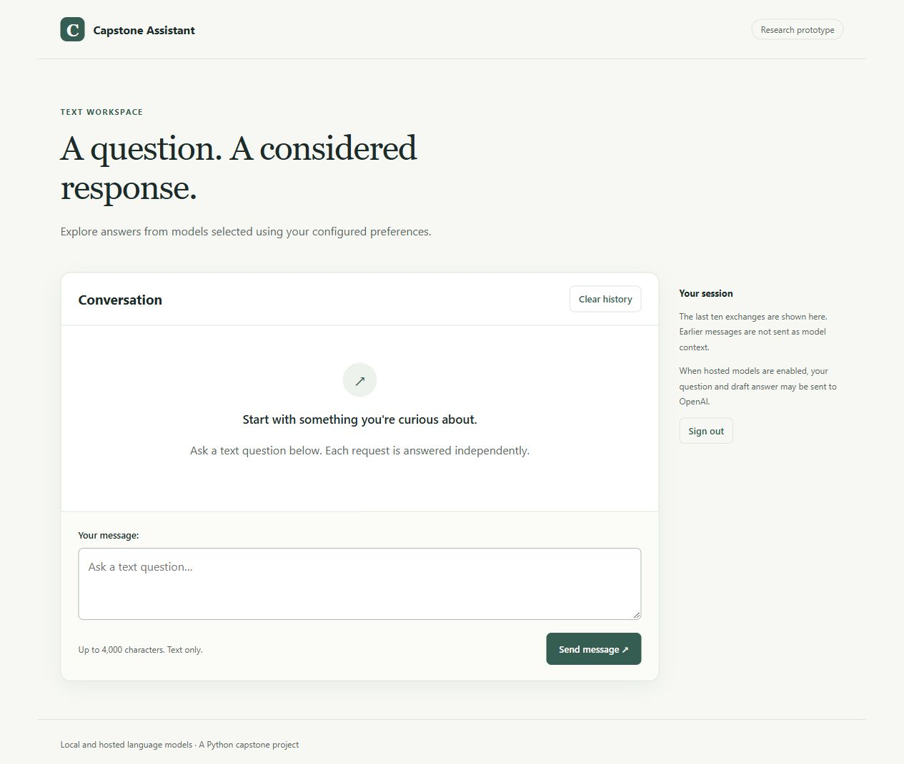

# Capstone Assistant

A Python capstone exploring heuristic selection between local and hosted language models, with a Django text interface and optional speech, camera, and wardrobe experiments.

**Status:** portfolio prototype. Automated checks cover routing, configuration, web behavior, and mocked providers/hardware. Live model quality and hardware compatibility are not benchmarked. No trained or fine-tuned model is included.

## What the project implements

- Shared Ollama and OpenAI model adapters.
- Model-generated prompt classification with validated subject, difficulty, reasoning, and vision fields.
- Selection using configured memory limits, permission to use hosted models, relative cost scores, and hand-assigned subject scores.
- An initial answer and, when a second eligible model exists, a revision pass.
- Login-protected Django text chat with bounded session history.
- Optional microphone recording, cached Whisper transcription, Coqui speech output, and explicit camera capture.
- A **separate** SQLite wardrobe CLI that stores clothing descriptions and requests outfit suggestions.

The underlying models, Django authentication, speech recognition, and synthesis engines are third-party work. The project integrates them. See [architecture and limitations](docs/ARCHITECTURE.md) and [credits](docs/ATTRIBUTION.md).

## Interface preview



Captured from the running local app. This empty-session screenshot makes no claim about a live model response. [Sign-in page](docs/images/login.jpg) · [Mobile view](docs/images/chat-mobile.jpg).

## Quick start: text interface

Use Python 3.11 or 3.12. Commands below run from the repository root.

```sh
git clone https://github.com/Liamtechever/CapstoneProject.git
cd CapstoneProject
python -m venv .venv
```

Activate the environment:

- PowerShell: `.\.venv\Scripts\Activate.ps1`
- macOS/Linux: `source .venv/bin/activate`

If PowerShell blocks activation, invoke `.\.venv\Scripts\python.exe` instead of `python` in the commands below.

```sh
python -m pip install --require-hashes -r requirements.txt
python scripts/setup_local.py
python manage.py migrate
python manage.py createsuperuser
python manage.py runserver 127.0.0.1:8000
```

Open [the local app](http://127.0.0.1:8000/) and sign in with the account you just created. There are no bundled accounts or passwords. Setup creates ignored local configuration with a unique Django key; it does not overwrite existing files.

The login and chat pages work without a provider key or speech packages. **Generating an answer requires a running model provider.**

### Local inference

Install [Ollama](https://ollama.com/) and start its local service. Pull the small models used by the default 4 GB routing configuration:

```sh
ollama pull deepseek-r1:1.5b
ollama pull tinyllama
```

These downloads are explicit; the app never pulls Ollama models. If an eligible model is missing or does not respond, the app shows an error. Registry memory estimates are approximate; actual memory use depends on quantization, context, and hardware.

### Hosted inference

Add your own `OPENAI_API_KEY` to the ignored `.env`, then edit `settings.json` to allow internet use and set a relative cost tolerance. For example:

```json
{
  "user_vram": 0,
  "use_internet": true,
  "api_cost_tolerance": 5
}
```

This allows eligible hosted text models while excluding local models that require memory. Models retained from the capstone include `gpt-3.5-turbo`, `o3-mini`, and `gpt-4-turbo`; availability depends on your account and the provider. Review `core/models.py` if a model becomes unavailable.

**Cost tolerance is a heuristic score, not a dollar budget.** One text request uses a classification call and an answer call, plus a revision call when two eligible models exist. Hosted mode sends the current question and potentially a draft answer to OpenAI. Previous chat exchanges are stored for display but are not included as model context.

## Other entry points

```sh
python main.py "Explain how a binary search works"
python main.py --voice
python main.py --camera "Describe the object in this image"
python Settings.py
python Fashion.py
```

Voice, camera, and spoken setup require optional packages and hardware. The wardrobe CLI is independent of Django. Its hosted image-description and outfit steps obey the same internet/cost settings; manual description remains available when image inference fails.

See [media setup](docs/MEDIA.md) before installing the larger dependencies. The web form supports text only.

## Repository map

| Location | Purpose |
| --- | --- |
| `core/` | Configuration, provider adapters, validated classification, routing, response pipeline |
| `chat/`, `chatproj/` | Django views, forms, templates, static assets, environment-specific settings |
| `media/` | Optional microphone, camera, transcription, and speech adapters |
| `interfaces/` | Explicit spoken configuration |
| `experiments/fashion/` | Standalone wardrobe program |
| `tests/`, `chat/tests.py` | Automated regression tests |
| `scripts/` | Local setup and tracked-file hygiene checks |
| `var/` | Ignored databases and runtime artifacts |
| Original capitalized modules | Small compatibility entry points |

## Development

```sh
python -m pip install --require-hashes -r requirements-dev.txt
python -m pytest
python -m ruff check .
python -m ruff format --check .
python -m pip check
python scripts/check_tracked_files.py
python -m pip_audit -r requirements.txt --no-deps --disable-pip
```

Tests use an isolated database and mocked provider/hardware calls. They do not require API credentials or model downloads. CI runs the text suite on Windows and Linux with Python 3.11/3.12. See [maintenance](docs/MAINTENANCE.md) for dependency updates and manual checks.

## Known limits

- Scores are manually assigned; routing is not learned or benchmarked.
- Difficulty and reasoning fields are validated but do not yet affect ranking.
- A revision pass is not evidence of improved accuracy.
- Model availability is checked by attempting inference, not by downloading or automatically substituting models.
- Chat requests are synchronous. There is no streaming, distributed rate limiter, or conversation memory.
- Speech/camera behavior requires manual hardware verification.
- Outfit IDs are validated, but semantic category correctness still depends on model output.
- This is not a production deployment guide. Read [security and migration notes](docs/SECURITY.md) before exposing it publicly.

Licensing is undecided. No open-source license is granted by this repository at present.
