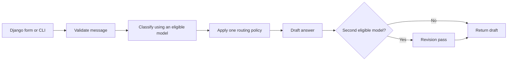

# Architecture

## Request flow

Each stage uses the same settings snapshot. Offline mode excludes hosted providers at classification, draft, and revision. Vision also applies memory and cost limits. No eligible model raises a controlled error.

The picker ranks eligible candidates by the original hand-assigned subject scores, breaking ties by cost score and name. Scores do not represent measured performance. A cost score is not currency. The old 671B entry has no verified memory requirement and is excluded from routing; its previous 48 GB claim was removed. The hosted vision score was normalized to 10 so it fits the configured 0–10 scale.

Internet permission allows hosted models alongside eligible local models. It does not force a hosted model. Set local memory allowance to zero to restrict selection to hosted entries. Memory limits describe a per-model eligibility estimate; they do not reserve GPU memory or account for simultaneous resident models.

## Boundaries

- `core/config.py` reads typed settings without prompts, writes, hardware detection, or speech initialization.
- `core/models.py` constructs clients only during explicit requests. Local requests target loopback Ollama. Hosted keys are loaded only when needed.
- `core/classifier.py` rejects missing/extra keys, unknown subjects, invalid difficulties, and non-boolean flags.
- `core/service.py` runs one classification, one draft, and at most one revision. There is no unrelated startup inference.
- `chat/` stores the last ten exchanges in the authenticated session, escapes content, and redirects after successful POST.
- `media/` imports heavy packages lazily. CLI captures use temporary directories and clean up on completion.
- `experiments/fashion/` uses its own SQLite database in `var/wardrobe/`. It is not a web chat feature.

The original capitalized modules remain as thin imports/entry points to make the transition discoverable. They no longer own provider or configuration logic.

## Accomplishments versus future work

Implemented: provider integration, validated classification, heuristic routing, staged responses, Django authentication/session UI, optional media adapters, and wardrobe CRUD with outfit ID validation.

Not demonstrated: training, fine-tuning, retrieval-augmented generation, learned routing, measured accuracy gains, guaranteed spending limits, low-latency serving, production-scale operation, or full conversation context.

The tests establish control flow and failure handling with deterministic substitutes. They cannot establish the quality of an LLM answer, account access to a hosted model, or compatibility with every camera/audio device.
